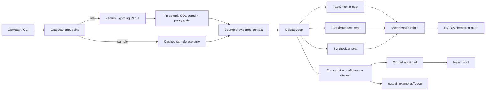

# GOVERNMINDZ

**A governed multi-agent debate system that explains its answer and shows the evidence behind it.**

GOVERNMINDZ runs role-based agents over Zetaris Lightning evidence, uses Meterless to drive the seats, and produces a signed audit trail, a machine-readable result, and a JSONL trace. It is built for the Open Agent Hackathon 2026.

## Track & Project Overview

- **Primary track:** Track 02 — The Agent That Can Explain Why.
- **Target user:** data platform teams, analytics governance groups, and reviewers who must defend an AI-assisted decision to another human.
- **Problem:** an agent can answer a question over federated data without showing which source it used, which agent disagreed, or why the final confidence changed. A fluent answer is not an auditable answer.
- **Core capabilities:**
  - Zetaris Lightning REST evidence gathering through a read-only SQL guard and policy gate.
  - Role-separated seats: FactChecker, CloudArchitect, and Synthesizer.
  - Bounded multi-round debate with confidence-aware consensus and dissent tracking.
  - Meterless Runtime seat calls using a JSON output contract.
  - Signed, hash-chained audit events and a verifiable run artifact.
  - Programmatic CLI entry points for live and key-free sample runs.
  - JSONL traces and generated output examples for review.

This is deliberately **not** a general chatbot. The CLI is the product surface: it takes a question, retrieves evidence, runs the debate, and writes an evidence bundle a reviewer can inspect.

## Architecture



The sample path uses the same `DebateLoop`, seats, prompts, consensus logic, and audit emitter as the live path. It replaces only the two external dependencies: cached Zetaris rows and cached seat replies.

## Installation & Setup

Requirements: Node.js 22 or later, npm, and (for a live run) a local Meterless Runtime plus access to a Zetaris Lightning instance.

```bash
git clone <this-repository-url>
cd governmindz
npm ci
```

Windows PowerShell:

```powershell
git clone <this-repository-url>
Set-Location governmindz
npm ci
```

Run the key-free sample immediately:

```bash
npm run demo:sample
```

For a live run, copy the environment template and fill in local values:

```bash
cp .env.example .env.local
```

Windows PowerShell:

```powershell
Copy-Item .env.example .env.local
```

Required for live mode:

- `AUDIT_TRAIL_SECRET` — generate with `node -e "console.log(require('crypto').randomBytes(32).toString('hex'))"`.
- `METERLESS_BASE_URL` — default `http://127.0.0.1:8088/v1`.
- `METERLESS_API_KEY` or a runtime `proxy-token` / `/connect` link — obtain from the local Meterless Runtime.
- `ZETARIS_REST_URL`, `ZETARIS_ORG_ID`, and a read-only `ZETARIS_API_KEY` — obtain from the Zetaris instance owner.

`.env.local` is gitignored. Never commit it, paste it into an issue, or include it in a log. `npm run demo:dry` verifies Zetaris and Meterless connectivity without making an LLM call:

```bash
npm run demo:dry
npm run demo
```

## Usage & Sample Commands

### Key-free sample mode

```bash
npm run demo:sample
```

This reads `input_examples/01-governance-readiness.json`, runs the real debate engine with cached Zetaris rows and cached seat replies, and writes:

- `output_examples/01-governance-readiness.json` — full generated result, seat votes, transcript, and audit events.
- `logs/01-governance-readiness.jsonl` — ordered run trace.

Generate all three submitted examples:

```bash
npm run samples
```

Run a specific scenario:

```bash
npm run demo:sample -- \
  --scenario input_examples/02-federated-evidence.json \
  --output output_examples/02-federated-evidence.json \
  --log logs/02-federated-evidence.jsonl
```

Windows PowerShell uses the same command on one line:

```powershell
npm run demo:sample -- --scenario input_examples/02-federated-evidence.json --output output_examples/02-federated-evidence.json --log logs/02-federated-evidence.jsonl
```

### Live mode

```bash
npm run demo
```

Optional live trace:

```powershell
$env:GOVERNMINDZ_LOG_PATH = 'logs/live-demo.jsonl'
npm run demo
```

Optional topic override:

```powershell
$env:GOVERNMINDZ_TOPIC = 'Which Zetaris source should be reviewed first, and why?'
npm run demo
```

### Validation commands

```bash
npm run typecheck
npm test
npm run smoke
npm run demo:dry
```

`npm test` is self-contained and does not require live services. `npm run smoke` and `npm run demo:dry` require the live environment configured in `.env.local`.

### Programmatic entry point

The entry scripts are `apps/gateway/src/main.ts` (live) and `apps/gateway/src/sample.ts` (sample). They are CLI-first and need no browser or server:

| Command | Purpose | Network |
| --- | --- | --- |
| `npm run demo:sample` | Run one cached scenario | None |
| `npm run samples` | Generate all example outputs and traces | None |
| `npm run demo:dry` | Check Zetaris and Meterless | Yes |
| `npm run demo` | Run a live debate | Yes |
| `npm run smoke` | Connectivity and contract checks | Yes |

Exit codes: `0` completed, `1` halted debate, `2` live Meterless unavailable.

## AI & Model Disclosures

- **Reasoning model:** the live path calls Meterless Runtime. The default global lane is `meterless/auto`, and the seat lane is `meterless/fast`. During verification, `meterless/fast` resolved to `nvidia/nemotron-3.5-lightning-30b-a3b`. The exact route is owned by the local Meterless Runtime and can change; the resolved model is reported by the runtime, not hard-coded as a guarantee.
- **Embeddings:** none. There is no vector store, embedding model, or semantic index in this repository.
- **Evaluator / judge:** there is no separate LLM judge. Consensus is a deterministic threshold over seat confidence, with a Synthesizer seat used when the threshold is not met. The Synthesizer is a normal model-backed seat, not a separate evaluator model.
- **Agent framework:** a custom TypeScript ESM implementation. The repository does not use LangGraph, CrewAI, AutoGen, OpenAI Agents SDK, or a hosted agent framework.
- **Prompting:** role prompts live in `libs/core/prompts/`. Every seat receives a JSON output contract and must return a position, confidence, evidence, caveats, dissent/support IDs, and optional reasoning.
- **Safety controls:** Zetaris access is read-only and policy-gated; the debate is capped at two rounds; the transcript is bounded; malformed seat JSON falls back to a lower-confidence contract; Meterless and Zetaris errors are redacted before display.
- **Determinism:** sample mode is deterministic in its seat replies because the replies are cached. Session IDs and timestamps still differ per run.

## Sponsor Technology Integration

### Zetaris

Zetaris is the evidence layer. The gateway calls the Zetaris Lightning REST SQL endpoint through `zetarisQueryHandler`, which rejects writes, DDL, multiple statements, `INTO`, and `FOR UPDATE` before any network call. The default query is `SHOW LIGHTNING DATABASES`; the live preflight returned three databases.

Zetaris is not used as a model provider. The evidence is formatted into a bounded context block and supplied to every seat. Sample mode uses the same result shape with synthetic cached rows.

Relevant files: `libs/core/src/integrations/zetarisClient.ts`, `apps/gateway/src/tools/zetaris.tools.ts`, `apps/gateway/src/format.ts`.

### Meterless

Meterless is the model execution layer. The gateway uses an OpenAI-compatible local runtime, resolves a token from `METERLESS_API_KEY`, `METERLESS_RUNTIME_TOKEN`, a `/connect` link, or the runtime `proxy-token` file, and calls `/models` and `/chat/completions`.

The provider supports plain-text prompts, typed content parts, retries, status detection, and token redaction. No Meterless token is committed. The runtime token is local state and must never be added to a reading sample or trace.

Relevant files: `libs/core/src/providers/MeterlessProvider.ts`, `MeterlessSeatClient.ts`, `MeterlessTokenStore.ts`.

### NVIDIA

NVIDIA Nemotron is reached indirectly through Meterless. In the verified run, the `meterless/fast` lane routed to `nvidia/nemotron-3.5-lightning-30b-a3b`. The repository does not bundle NVIDIA model weights and does not require a direct NVIDIA API key. If the local Meterless Runtime has no NVIDIA route, the same code can use another Meterless lane without changing the debate engine.

### Cursor (with Space XAI)

Cursor was integrated at the start of the project and remained in use. The project is now developed with Cursor as the primary editor while OpenCode is used in the terminal side panel. Cursor/SpaceXAI are development workflow tools, not runtime dependencies: there is no Cursor- or SpaceXAI-specific runtime dependency, configuration, or integration in the repository.

## Data Sources & Licensing

- **Live data:** the default live query is a read-only `SHOW LIGHTNING DATABASES` against the operator's Zetaris Lightning instance. The data remains in Zetaris and is subject to the instance owner's terms.
- **Sample data:** all rows in `input_examples/` are synthetic and small. They contain no personal data, customer data, credentials, or production identifiers.
- **No bulk datasets:** the repository does not bundle datasets, checkpoints, model weights, or database dumps. `node_modules/`, `.env.local`, and generated caches are ignored.
- **Output examples:** `output_examples/` contains generated sample-mode results for review. They are illustrative and are not legal, financial, or operational advice.
- **Licensing:** third-party dependencies are listed below. The repository does not vendor third-party source files. Zetaris, Meterless, and NVIDIA are used as external services under their own terms.

## Third-Party Code & Attributions

The implementation uses Node.js built-ins and two development dependencies:

| Component | Version | License | Use |
| --- | --- | --- | --- |
| TypeScript | `^6.0.3` | Apache-2.0 | Type checking and language support |
| tsx | `^4.20.6` | MIT | TypeScript execution for the CLI and tests |
| esbuild | transitive via tsx | MIT | TypeScript transform used by tsx |

No third-party source files are copied into this repository. Zetaris, Meterless, and NVIDIA are referenced as services and model routes, not redistributed code.

## Sample Mode (`SAMPLE_MODE=true`)

Sample mode exists so a judge can verify the agent loop without receiving live API keys or starting external services.

```bash
npm run demo:sample
```

What happens:

1. `apps/gateway/src/sample.ts` sets `SAMPLE_MODE=true` and, only when no audit secret is present, sets the non-production value `sample-mode-local-audit-secret`. This is a local demo signing key, not a secret for any deployed system.
2. `main.ts` loads the selected scenario from `input_examples/`.
3. Cached Zetaris rows are formatted into the same evidence context used by live mode.
4. A `SampleSeatClient` returns the scenario's cached seat replies through the real `ILLMClient` contract.
5. `DebateLoop`, the seats, consensus rules, transcript, and `AuditTrailEmitter` run unchanged.
6. The run writes a full JSON result and a JSONL trace.

Optional overrides:

- `SAMPLE_SCENARIO` or `--scenario`
- `SAMPLE_OUTPUT` or `--output`
- `SAMPLE_LOG` or `--log`

The cached replies are synthetic test fixtures, not claims about model quality. The live path is the model-backed path.

## Evidence Artifacts

| Artifact | Path | Contents |
| --- | --- | --- |
| Sample inputs | `input_examples/01-*.json`, `02-*.json`, `03-*.json` | Three topics, cached Zetaris rows, cached seat replies |
| Generated outputs | `output_examples/*.json` | Result, transcript, seat votes, confidence, audit events |
| Sample traces | `logs/*.jsonl` | Ordered run start, agent messages, audit events, run completion |
| Live trace | `logs/live-demo.jsonl` | A real Meterless/Zetaris run when generated |
| Architecture | this README | Mermaid flow from evidence to audit |

The JSON and JSONL artifacts are generated by the code, not hand-written. The sample logs are labeled `"mode":"sample"`; live traces are labeled `"mode":"live"`.

## Known Limitations

- The live path requires a local Meterless Runtime and a reachable Zetaris instance. It is not a hosted service.
- The audit trail is in-process and hash-chained; there is no durable WORM store, external timestamping, or HSM-backed signing in this demo.
- Zetaris access is intentionally read-only. This build does not perform writes, schema changes, or remediation actions.
- The demo has three seats and a two-round cap. It is not a general-purpose agent orchestrator.
- The default live query is only a database inventory. The agent does not automatically discover schemas or generate SQL for arbitrary user questions.
- Sample replies are synthetic. They verify orchestration, consensus, audit, and artifact generation, not model accuracy.
- The Meterless model route is runtime-dependent. A different runtime or lane can resolve to a different model.
- There is no web UI, multi-tenant authorization model, billing layer, or production deployment manifest.
- Cursor/SpaceXAI is not integrated; NVIDIA is reached through Meterless rather than a direct NVIDIA API.
- JDBC is documented in `.env.example` for the separate Zetaris onboarding scripts but is not wired into this gateway.

## Pre-Existing Components

This submission builds on an existing ACR Logic baseline that predates the hackathon build window. The pre-existing portion includes the debate kernel (`DebateLoop`, `AgentSeat`, `SeatTransport`), the prompt registry and role prompts, the audit trail, the Gravity receipt primitive, and the provider abstraction.

The hackathon work added:

- The Zetaris Lightning REST client, read-only SQL guard, and policy-gated tool.
- The Meterless provider, seat client, token store, status handling, and retry behavior.
- The gateway CLI entry point and live evidence flow.
- Key-free sample mode, cached scenarios, generated outputs, and JSONL traces.
- The README, validation commands, and example artifacts.

Pre-existing code is included so the demo is runnable and reviewable. New work should be assessed against the capabilities and evidence added during the build window.

## Security & Secrets

- `.env.local` is gitignored; only `.env.example` placeholders are tracked.
- No API key, runtime token, connect link, or audit signing key is committed.
- `MeterlessProvider` and the Zetaris client redact authentication values from error messages.
- The sample audit key is a fixed local demo value and is not valid for production.
- `AUDIT_TRAIL_SECRET` and `KMS_MASTER_KEY` are required only for the features that use them. Generate unique values for any real deployment.
- The JSONL trace records messages, evidence, hashes, and signatures. It does not record the audit signing key or provider token.
- If a key is exposed in a terminal transcript or chat, rotate it immediately. The `.env.local` values are never part of the repository.

## Verification Performed

- `npm run typecheck` — clean.
- `npm test` — 23/23 passing.
- `npm run demo:sample` — sample debate completed with consensus and audit integrity true.
- `npm run samples` — generated all three sample outputs and traces.
- `npm audit` — 0 vulnerabilities.
- Live Zetaris REST `SELECT 1` and `SHOW LIGHTNING DATABASES` — successful; three databases returned.
- Live Meterless status — online; full two-round debate completed with synthesizer consensus, confidence `0.90`, and audit integrity true.
- Secret scans — no tracked `.env.local`, tokens, or keys; `.env.local` is ignored.

## Event

Open Agent Hackathon 2026 · October 22–27, 2026 · submissions close October 27, 2026, 23:45 UTC.

Event page: <https://hackathon.genai.works/event/open-agent-hackathon-2026>
