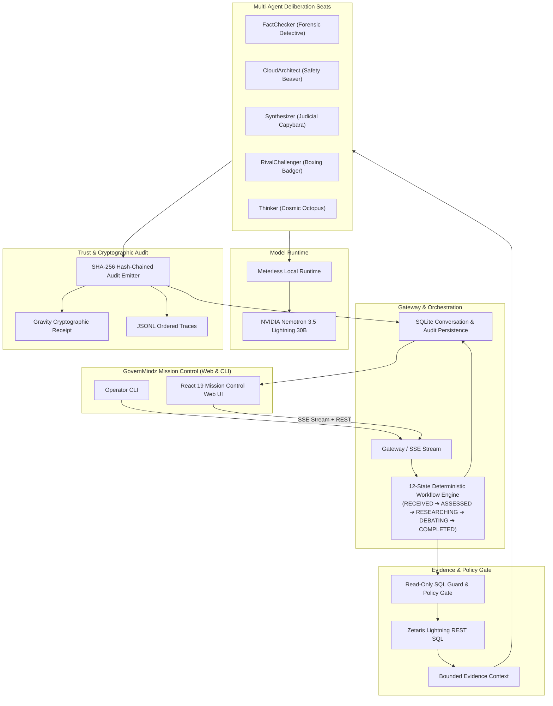

<p align="center"></p>

# GOVERNMINDZ

**A governed, competition-ready multi-agent debate and explanation platform that shows the exact evidence, disagreements, and cryptographic proof behind AI decisions.**

GOVERNMINDZ runs role-separated agents over Zetaris Lightning evidence, executes seat inference via local Meterless Runtime (routing to NVIDIA Nemotron), maintains a 12-state deterministic workflow engine, and produces a tamper-evident SHA-256 signed audit trail. Built for the **Open Agent Hackathon 2026**.

Available both as an **interactive Mission Control Web Application** (React 19, TypeScript, Vite, Tailwind CSS v4, Lucide React, SQLite persistence) and a **production-grade CLI pipeline**.

---

## Track & Project Overview

- **Primary track:** Track 02 — The Agent That Can Explain Why.
- **Target user:** Data platform teams, analytics governance groups, compliance officers, and reviewers who must defend an AI-assisted decision to another human.
- **Problem:** Conventional LLM agents provide fluent but untraceable answers over federated data—failing to show which table was queried, which agent objected, how confidence evolved, or whether the transcript was altered.
- **Core capabilities:**
  - **Zetaris Lightning REST Evidence:** Read-only SQL guard and policy gate preventing writes, DDL, injections, and unauthorized catalog access.
  - **Role-Separated Multi-Agent Roster:** FactChecker, CloudArchitect, Synthesizer, RivalChallenger, and Thinker with distinctive identities, funny persona quirks, and visual character avatars.
  - **Bounded Deliberative Consensus:** Multi-round structured debate with dual-confidence scoring (self-confidence + expert agreement) and explicit dissent tracking.
  - **Meterless Model Execution:** Local-first OpenAI-compatible runtime resolving to NVIDIA Nemotron with deterministic JSON output contracts.
  - **Cryptographic Audit Trail:** In-memory and SQLite-persisted SHA-256 hash-chained ledger guaranteeing tamper evidence.
  - **GovernMindz Mission Control Web UI:** Competition-ready 3-view interface (AI Group Conversation, 12-State Execution Explorer, Trust & Evidence Ledger) with Server-Sent Events (SSE) live streaming and local SQLite conversation history.
  - **Playwright Automated Browser Testing:** Full end-to-end test suite capturing live session videos and screenshots.

---

## Architecture



---

## Mission Control Web Interface

The web interface (`apps/web/`) provides an elegant, modern group conversation experience supported by deep observability across three integrated views:

1. **View A — AI Group Conversation:**
   - Real-time SSE streaming of agent proposals, rebuttals, challenges, and consensus votes.
   - **Expressive Character Avatars:** Each agent features a custom-drawn, humorous SVG character illustration matching their mandate (e.g., FactChecker's forensic monocle & magnifying glass, CloudArchitect's safety hard hat & blueprints, Synthesizer's judicial wig & gavel, RivalChallenger's boxing gloves, Thinker's wire glasses & teacup).
   - **Persona Catchphrases:** Humorous thought bubbles capturing each seat's unique governance priority.
   - **Dual Confidence Telemetry:** Real-time visualization of individual Self-Confidence alongside cross-seat Expert Agreement percentages.
   - **Evidence & Caveat Chips:** Interactive verification pills for cited tables, least-privilege caveats, and dissent records.
   - **Synthesized Final Answer Card:** High-contrast amber card highlighting the calibrated final confidence score, consensus method, and cryptographic sign-off.
   - **Collapsible Agent Inspector Drawer:** Detailed slide-over displaying role boundaries, active tools, and complete contribution history.

2. **View B — Deterministic Execution Explorer:**
   - Visual step progression through the 12-state formal state machine (`RECEIVED`, `ASSESSED`, `CONTEXT_READY`, `RESEARCHING`, `DEBATING`, `FINAL_REVIEW`, `COMPLETED`).
   - Chronological transition log with exact microsecond timestamps, triggering agents, and state payload inspector.

3. **View C — Trust & Evidence Catalog & Cryptographic Ledger:**
   - **Zetaris Lightning Federated Data Catalog:** Interactive tabular explorer for federated databases, row counts, and data classifications.
   - **Tamper-Evident SHA-256 Ledger:** Live block-by-block hash-chain viewer verifying unbroken sequential hashes from genesis to session completion.

4. **Persistence & System Settings:**
   - Durable SQLite conversation database (`data/conversations.db`) with full search, rename, export, and delete capabilities.
   - Settings modal providing live connectivity probes for Meterless Runtime and Zetaris Lightning.

---

## Quickstart & Installation

### Requirements

- **Node.js:** v22.0.0 or later
- **npm:** v10.0.0 or later
- **OS:** Windows, macOS, or Linux

```bash
git clone https://github.com/ACR-LOGIC/governmindz.git
cd governmindz
npm ci
```

Windows PowerShell:

```powershell
git clone https://github.com/ACR-LOGIC/governmindz.git
Set-Location governmindz
npm ci
```

---

## Usage Commands

### 1. Launch Mission Control Web UI

```bash
npm run web
```

Open **`http://127.0.0.1:8787`** in your browser. The web UI operates out of the box in key-free sample mode or live mode with SQLite conversation persistence.

For frontend development with Vite Hot Module Replacement (HMR):

```bash
npm run dev
```

(Runs on `http://127.0.0.1:5173` with automatic reverse proxying of `/api` to the backend on port 8787).

---

### 2. Run Playwright Automated Browser Tests (with Video Recording)

Playwright runs headless Chromium against the application stack, exercising all 3 views, message submission, agent drawer inspection, settings, and captures high-resolution screenshots and video:

```bash
npm run test:e2e
```

- **Video Recording:** Automatically written to `test-results/recordings/govern_mindz_e2e_full_journey.webm`.
- **View Screen Captures:** Saved to `test-results/recordings/screenshots/`.

---

### 3. Run Backend Unit & Integration Tests

```bash
npm test
```

Executes the complete test suite (**57 / 57 passing**):
- **Gravity Receipt Tests (5/5):** Verification, master key enforcement, and signature validity.
- **Meterless Provider Tests (12/12):** URL normalization, auth token resolution, chat completion contract, retry logic, and status detection.
- **Zetaris SQL Guard Tests (6/6):** Semicolon parsing, read-only SQL assertion, DDL/write rejection, and HTTP error sanitization.
- **12-State Workflow State Machine Tests (34/34):** State transitions, cycle bounds, inquiry scoring, intervention triggers, and audit hash-chain integrity.

---

### 4. CLI Entry Points

| Command | Purpose | Network Required |
|---|---|---|
| `npm run web` | Launch Mission Control Web Server | Optional (works offline) |
| `npm run dev` | Launch Vite Dev Server with HMR | Optional |
| `npm run build` | Build production frontend bundle (`apps/web/dist`) | None |
| `npm run test:e2e` | Run Playwright E2E browser tests with recording | None (local server) |
| `npm test` | Run all 57 backend core test suites | None |
| `npm run typecheck` | Run full project TypeScript verification | None |
| `npm run demo:sample` | Run deterministic sample debate scenario | None |
| `npm run samples` | Generate all sample outputs and JSONL traces | None |
| `npm run demo:dry` | Verify Zetaris and Meterless connectivity | Yes |
| `npm run demo` | Run live multi-agent debate | Yes |
| `npm run smoke` | Preflight contract and API health checks | Yes |

---

## AI & Model Disclosures

- **Reasoning Model:** The live path invokes local Meterless Runtime (`http://127.0.0.1:8088/v1`). The seat lane defaults to `meterless/fast`, resolving to `nvidia/nemotron-3.5-lightning-30b-a3b`. No direct cloud API key is needed.
- **Evaluator / Judge:** No separate LLM judge. Consensus is evaluated deterministically based on calibrated seat confidence thresholds, invoking the Synthesizer seat when deliberation requires cross-seat reconciliation.
- **Embeddings:** None. There are no vector stores, external vector databases, or semantic embeddings.
- **Agent Architecture:** Custom TypeScript ESM state-machine kernel (`libs/core/`). No heavy third-party agent frameworks (LangGraph, CrewAI, AutoGen) are required.
- **Safety Controls:** Zetaris SQL statements pass through an AST/regex policy gate rejecting non-read statements prior to socket dispatch; debate loops are strictly bounded by turn counters and cycle detectors to prevent infinite loops.

---

## Sponsor Technology Integration

### 1. Zetaris Lightning
Zetaris serves as the federated data evidence layer. Queries are executed via the REST endpoint through `assertReadOnlySql()`. The preflight query `SHOW LIGHTNING DATABASES` supplies live catalog evidence into the deliberation context.

### 2. Meterless
Meterless operates as the local zero-cost model runtime. The client supports `/connect` links, `proxy-token` auto-discovery, structured JSON schema response constraints, and automatic retry backoff.

### 3. NVIDIA Nemotron
Routed through Meterless, NVIDIA Nemotron 3.5 Lightning 30B provides fast, high-quality reasoning across all debate seats without incurring external cloud bills.

---

## Security & Privacy

- **Local-First Zero External Leakage:** All sample runs, SQLite databases, and Meterless inferences execute entirely locally.
- **Secrets Protection:** `.env.local` is gitignored. Runtime tokens, audit signing secrets, and connect URLs are automatically redacted from error traces and logs.
- **Cryptographic Auditability:** Every agent proposal, dissent, intervention, and workflow state transition is minted into an unbroken SHA-256 hash chain with HMAC signatures.

---

## Hackathon Submission Metadata

- **Event:** Open Agent Hackathon 2026 (October 22–27, 2026)
- **Track:** Track 02 — The Agent That Can Explain Why
- **Repository:** `https://github.com/ACR-LOGIC/governmindz`
- **License:** Apache-2.0 / MIT
