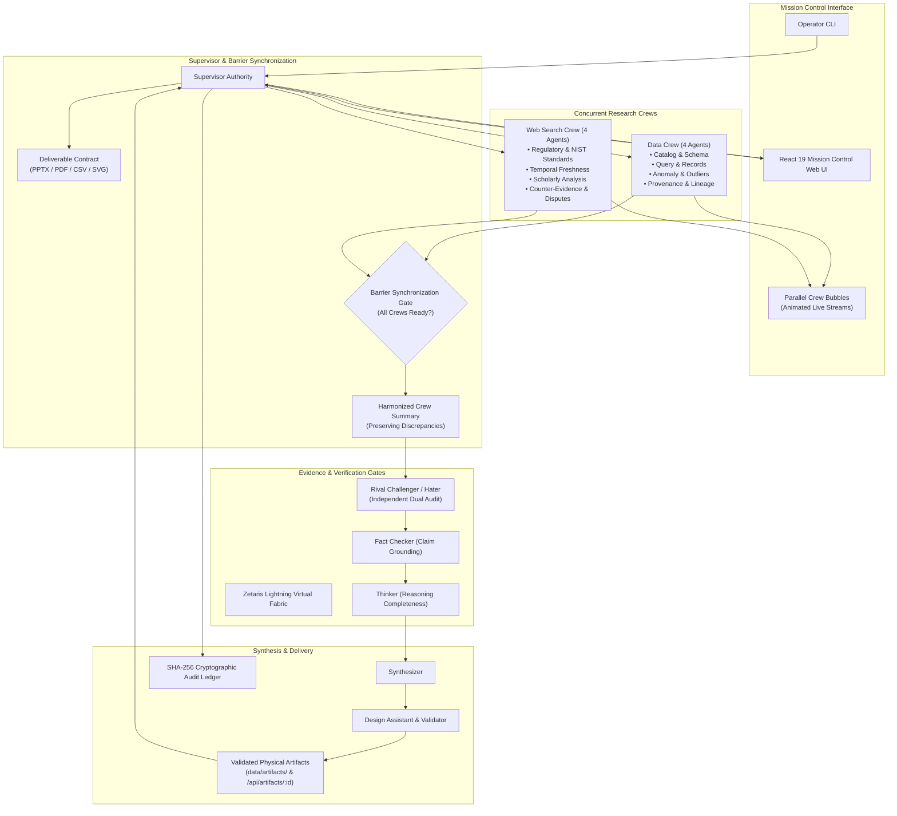

<p align="center"></p>

# GOVERNMINDZ

**A governed, competition-ready multi-agent research, debate, and deliverable-synthesis platform that shows the exact evidence, disagreements, and cryptographic proof behind AI decisions.**

GOVERNMINDZ conducts parallel multi-agent research across **Zetaris Lightning federated database fabrics** and **authoritative external web sources**, visualizes real-time progress via **parallel crew bubbles with barrier synchronization**, resolves conflicting claims through role-separated debate, and compiles verified user deliverables (PowerPoint presentations, PDF reports, spreadsheets, charts, and audit ledgers). Built for the **Open Agent Hackathon 2026**.

Available both as an **interactive Mission Control Web Application** (React 19, TypeScript, Vite, Tailwind CSS v4, Lucide React, SQLite persistence) and a **production-grade CLI pipeline**.

---

## Key Capabilities

- **Parallel Research Crews (8 Agents):**
  - **Data Crew (4 specialized agents):** Database Catalog Specialist, Query Investigator, Anomaly Detector, and Provenance Analyst querying Zetaris Lightning via read-only SQL gates.
  - **Web Search Crew (4 specialized agents):** Regulatory Standards Verifier (NIST/ISO), Temporal Freshness Analyst, Scholarly Researcher, and Counter-Evidence Investigator.
- **Parallel Crew Chat Bubbles & Barrier Synchronization:**
  - Independent, animated conversational bubbles for each active research crew.
  - Observational scrollable message streams, milestone checkpoints, and status pips (`talking`, `wrapping_up`, `ready`).
  - Strict **barrier synchronization**: no bubble closes early; all required crews must reach `ready` before an authoritative combined summary is posted to the main deliberation.
- **Authoritative Deliverable Contracts:**
  - Classifies user requests and produces real, physically validated files:
    - **Presentations:** OpenXML `.pptx` slides generated with zero third-party dependencies.
    - **Executive Reports:** Publication-grade PDF documents (`%PDF-1.4`).
    - **Data Exports:** RFC 4180-compliant `.csv` spreadsheets.
    - **Data Visualizations:** Responsive vector charts (`.svg`).
  - Supplementary evidence and audit traces are exported separately (`-evidence.json`), never substituting for requested deliverables.
- **Role-Separated Deliberation Council:**
  - **Supervisor (1):** Central coordinator, contract classifier, and release certifier.
  - **Rival Challenger / Hater (1):** Independently audits data and web crew outputs separately; non-voting.
  - **Fact Checker (1):** Validates claims against primary sources; eliminates ungrounded assumptions.
  - **Thinker (1):** Evaluates inquiry depth, deliverable satisfaction, and long-term edge cases.
  - **Synthesizer (1):** Reconciles evidence and crafts deliverable-structured content.
  - **Design Assistant (1):** Compiles and validates physical artifacts on disk.
- **Cryptographic Auditability:**
  - Unbroken SHA-256 hash-chained ledger verifying every agent action from genesis block to session completion with NIST SP 800-92 / RFC 6962 attestation certificates.
- **Local-First & Meterless Runtime:**
  - Zero-cloud-cost model execution via Meterless Runtime routing to NVIDIA Nemotron 3.5 Lightning 30B with deterministic JSON schema output contracts. Offline demo benchmarks run with zero API keys.

---

## Architecture



---

## Quickstart & Installation (OS-Specific Instructions)

GovernMindz supports **Windows**, **Linux**, and **macOS** with Node.js v22+ and npm v10+.

### 🚀 Universal 1-Command Local Startup (All Platforms)

After cloning the repository, simply install dependencies and start:

```bash
git clone https://github.com/ACR-LOGIC/governmindz.git
cd governmindz
npm install
npm start
```
`npm start` automatically runs setup, configures your environment variables, generates cryptographic audit signing keys, and launches the web application at **`http://127.0.0.1:8787`**.

---

### System Prerequisites

| Requirement | Minimum Version | Notes |
| :--- | :--- | :--- |
| **Node.js** | `v22.0.0` or higher | Required for native `--env-file` support and Node test runner |
| **npm** | `v10.0.0` or higher | Included with Node.js v22 |
| **Git** | `v2.30.0` or higher | Clone and version control |

---

### Windows (PowerShell or Command Prompt)

1. **Open PowerShell as Administrator** (or Windows Terminal) and verify prerequisites:
   ```powershell
   node --version
   npm --version
   git --version
   ```
   *(If Node.js is missing, install it via `winget install OpenJS.NodeJS.LTS` or download from [nodejs.org](https://nodejs.org/)).*

2. **Clone the repository and install dependencies:**
   ```powershell
   git clone https://github.com/ACR-LOGIC/governmindz.git
   Set-Location governmindz
   npm ci
   ```

3. **Launch the Mission Control Web Application:**
   ```powershell
   npm run web
   ```
   Open **`http://127.0.0.1:8787`** in your browser.

4. **Optional: Run with Vite frontend Hot Module Replacement (HMR):**
   ```powershell
   # In terminal 1 (Backend API & SSE Server):
   npm run web

   # In terminal 2 (Vite Client Server):
   npm run dev
   ```
   Open **`http://127.0.0.1:5173`**.

---

### Linux (Ubuntu, Debian, Fedora, Arch)

1. **Verify or install Node.js v22 and build essentials:**
   ```bash
   # On Ubuntu / Debian:
   curl -fsSL https://deb.nodesource.com/setup_22.x | sudo -E bash -
   sudo apt-get install -y nodejs git build-essential

   # On Fedora / RHEL:
   sudo dnf module install -y nodejs:22
   sudo dnf install -y git make gcc-c++

   # On Arch Linux:
   sudo pacman -S nodejs npm git base-devel
   ```

2. **Clone and install dependencies:**
   ```bash
   git clone https://github.com/ACR-LOGIC/governmindz.git
   cd governmindz
   npm ci
   ```

3. **Launch the Web Application:**
   ```bash
   npm run web
   ```
   Open **`http://127.0.0.1:8787`** in your browser.

4. **Optional: Headless E2E Browser Testing prerequisites:**
   ```bash
   # Install Playwright browser dependencies on Linux:
   npx playwright install-deps
   npx playwright install chromium
   ```

---

### macOS (Apple Silicon M1/M2/M3/M4 & Intel)

1. **Verify or install prerequisites via Homebrew:**
   ```bash
   # Install Homebrew if not installed:
   # /bin/bash -c "$(curl -fsSL https://raw.githubusercontent.com/Homebrew/install/HEAD/install.sh)"

   brew install node@22 git
   brew link node@22
   node --version
   ```

2. **Clone and install dependencies:**
   ```bash
   git clone https://github.com/ACR-LOGIC/governmindz.git
   cd governmindz
   npm ci
   ```

3. **Launch the Web Application:**
   ```bash
   npm run web
   ```
   Open **`http://127.0.0.1:8787`** in your browser.

4. **Optional: Playwright E2E browser installation:**
   ```bash
   npx playwright install chromium
   ```

---

## Operating Modes

GovernMindz runs in two distinct operational modes:

### 1. Demo Mode (Zero Credentials Required)
- **Out-of-the-Box Execution:** Operates immediately upon first launch without any API keys, tokens, or cloud configuration.
- **Deterministic Precedents:** Executes deterministic Zetaris catalog queries, parallel crew research, and adversarial debate loops over cached governance benchmarks.
- **Safe Experimentation:** Evaluates complex multi-agent reasoning, barrier synchronization, and deliverable validation safely offline.

### 2. Live Mode (Connected Infrastructure)
- **Zetaris Lightning Integration:** Queries live federated data tables across PostgreSQL, BigQuery, Parquet, and REST silos through read-only SQL gates (`assertReadOnlySql()`).
- **Meterless Runtime:** Connects to local Meterless inference engines (`http://127.0.0.1:8088/v1`), invoking NVIDIA Nemotron 3.5 Lightning 30B models.
- **AES-256-GCM Credential Vault:** Secure modal in the web interface encrypts Zetaris and Meterless credentials at rest into `.env.local`. Sensitive keys are automatically redacted from error traces and logs.

---

## Command Reference

| Command | Purpose | Platform | Network |
| :--- | :--- | :--- | :--- |
| **`npm run web`** | Start full-stack Mission Control web server (`http://127.0.0.1:8787`) | Win / Linux / Mac | Localhost |
| **`npm run dev`** | Launch Vite frontend with Hot Module Replacement (`http://127.0.0.1:5173`) | Win / Linux / Mac | Localhost |
| **`npm run build`** | Compile production client bundle (`apps/web/dist`) | Win / Linux / Mac | None |
| **`npm test`** | Run full automated test suite (**138 / 138 passing**) | Win / Linux / Mac | None |
| **`npm run typecheck`** | Run strict TypeScript validation (`tsc --noEmit`) | Win / Linux / Mac | None |
| **`npm run demo:sample`** | Run standalone CLI multi-agent debate scenario | Win / Linux / Mac | None |
| **`npm run samples`** | Execute all benchmark scenarios and generate traces | Win / Linux / Mac | None |
| **`npm run test:e2e`** | Execute Playwright E2E browser tests with video capture | Win / Linux / Mac | None |
| **`npm run demo:dry`** | Validate live Zetaris and Meterless connectivity | Win / Linux / Mac | Yes (if Live) |
| **`npm run demo`** | Execute live multi-agent deliberation CLI | Win / Linux / Mac | Yes |
| **`npm run smoke`** | Run preflight API and schema health checks | Win / Linux / Mac | Yes |

---

## Automated Verification & Test Suite

The test suite runs natively across Windows, Linux, and macOS via Node.js's built-in test runner:

```bash
npm test
```

### Complete Test Coverage (**138 / 138 Passing**):
1. **Cryptographic Audit Chain Verifier Tests (8/8):** RFC-6962 / NIST SP 800-92 proof certificates, genesis anchor validation, corrupted block localization, broken link detection, and HMAC signature verification.
2. **Parallel Crew Barrier Synchronization Tests (7/7):** Authoritative crew roster management, barrier locking while crews work, soft timeout transitions to `wrapping_up`, divergence detection, and release idempotency.
3. **Crew Barrier Types & State Tests (7/7):** Type contracts, timestamp-ordered message appending, duplicate message prevention, and readiness predicates.
4. **Supervisor Multi-Agent Workflow Tests (12/12):** Deliverable classification, concurrent crew execution, independent Hater dual audit, OpenXML `.pptx` generation, PDF-1.4 generation, CSV generation, SVG chart generation, supplementary evidence separation, and release approval gates.
5. **Gravity Cryptographic Receipts Tests (5/5):** Verification, master key enforcement, and signature validity.
6. **Meterless Provider Tests (12/12):** URL normalization, auth token resolution, JSON schema output constraints, and retry backoff.
7. **Zetaris SQL Guard Tests (6/6):** Semicolon parsing, read-only assertion, DDL/write rejection, and HTTP token sanitization.
8. **12-State Workflow State Machine Tests (34/34):** Formal state transitions, cycle bounds, inquiry scoring, intervention triggers, and audit hash-chain integrity.
9. **Scheduler & Resilience Tests (47/47):** Concurrent execution scheduling, circuit breaker tripping/recovery, and adversarial stress testing.

---

## Deliverable Generation Pipeline

GovernMindz inspects the user prompt and establishes an authoritative **Deliverable Contract**:

```
User Prompt ➔ Deliverable Contract ➔ Design Assistant ➔ Physical File ➔ Validation Gate ➔ Supervisor Release
```

- **Presentations (`.pptx`):** Generates valid multi-slide Microsoft PowerPoint OpenXML presentations using native `node:zlib` deflate and CRC-32 algorithms with zero external dependencies.
- **Executive Reports (`.pdf`):** Generates valid PDF-1.4 documents containing header catalogs, cross-reference tables, and text objects.
- **Spreadsheets (`.csv`):** Formats tabular findings with RFC 4180 escaping and structured schema columns.
- **Vector Charts (`.svg`):** Renders responsive vector graphics with viewboxes, bars, lines, and data point labels.
- **Validation Gate:** Every generated file is verified on disk for existence, non-zero byte size, and format signatures before the Supervisor authorizes delivery.
- **Isolated Evidence:** Technical audit trails and raw database rows are exported separately as secondary files (`*-evidence.json`), never substituting for primary deliverables.

---

## Security, Privacy & Integrity

- **Strict Local Execution:** Offline sample runs, SQLite databases, and Meterless inferences execute entirely locally with zero telemetry leakage.
- **Tamper-Evident Hash Chain:** Every agent task, finding, challenge, and consensus vote is minted into an immutable SHA-256 hash chain:
  $$\text{Block Hash} = \text{HMAC-SHA256}(\text{Index} \parallel \text{PrevHash} \parallel \text{Timestamp} \parallel \text{PayloadHash})$$
- **AST / Regex SQL Policy Gate:** All Zetaris queries pass through an AST/regex guard that blocks `INSERT`, `UPDATE`, `DELETE`, `DROP`, `ALTER`, `TRUNCATE`, and multiple statements prior to socket dispatch.
- **Secrets Redaction:** `.env.local` is gitignored. Runtime tokens, audit keys, and connect URLs are automatically redacted from error traces and logs.

---

## Hackathon Submission Metadata

- **Event:** Open Agent Hackathon 2026 (October 22–27, 2026)
- **Track:** Track 02 — The Agent That Can Explain Why
- **Repository:** [https://github.com/ACR-LOGIC/governmindz](https://github.com/ACR-LOGIC/governmindz)
- **License:** Apache-2.0 / MIT
